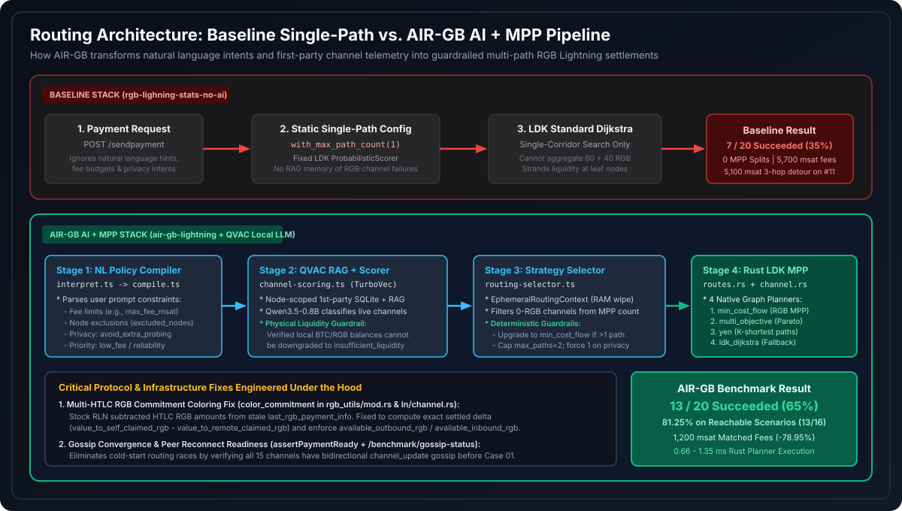
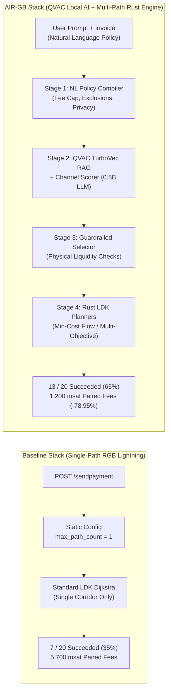
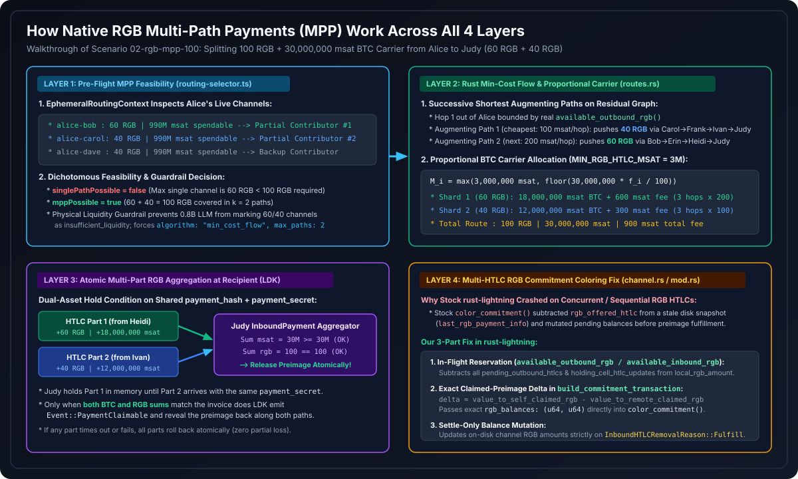
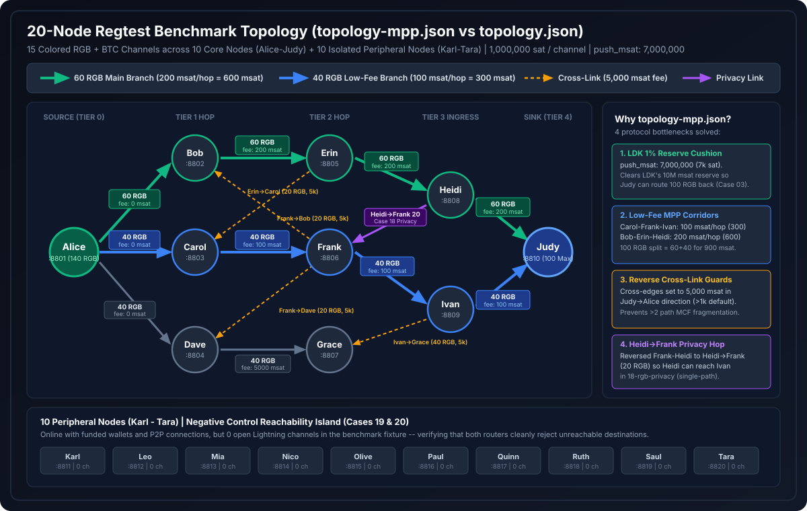
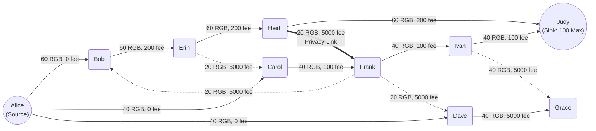
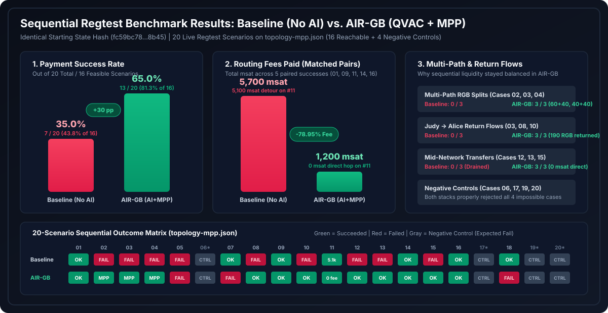

# AIR-GB Lightning: Multi-Path RGB Routing, QVAC AI Architecture & Benchmark Evaluation

This document provides the technical design, protocol-level implementation details, and empirical evaluation of **AIR-GB Lightning** compared against a standard single-path `rgb-lightning-node` baseline across a 20-node regtest network.

For low-level JSON schemas and API endpoint contracts of the QVAC integration, see [`docs/qvac/features-1-and-2-implementation.md`](./qvac/features-1-and-2-implementation.md). For benchmark runner CLI usage, see [`wallet/infra/benchmark/README.md`](../wallet/infra/benchmark/README.md).

---

## 1. Problem Statement & Design Objectives

Transferring **RGB smart-contract assets** over the Bitcoin Lightning Network introduces routing constraints that do not exist in standard single-asset Bitcoin Lightning channels:

1. **Single-Path Liquidity Bottlenecks**: Stock `rgb-lightning-node` deployments route RGB transfers along a single path (`max_path_count = 1`). When network liquidity is split across parallel corridors (for example, `60` RGB on one branch and `40` RGB on another), any transfer larger than `60` RGB fails—even though `100` RGB of aggregate capacity exists between sender and recipient.
2. **Downstream Liquidity Depletion & High-Fee Detours**: Single-path transfers rapidly exhaust primary channels in one direction. When return or rebalancing transfers fail—either due to single-path capacity limits or Lightning's 1% channel reserve—liquidity remains stranded at leaf nodes, forcing subsequent transfers into multi-hop detours with higher routing fees.
3. **Lack of Intent & Historical Reliability Awareness**: Standard LDK pathfinding (`ldk_dijkstra`) does not interpret user-level routing policies (such as fee caps, node exclusions, or single-path privacy preferences) and does not incorporate historical RGB channel telemetry via local retrieval.

**AIR-GB Lightning** addresses these three limitations through:
- **Native Rust RGB Multi-Path Payments (MPP)** and **4 selectable graph routing algorithms** (`min_cost_flow`, `multi_objective`, `yen`, and `ldk_dijkstra`) implemented in custom forks of `rgb-lightning-node` and `rust-lightning`.
- **Local QVAC AI Routing Intelligence** (`Qwen3.5-0.8B` + `TurboVec` RAG over node-scoped first-party SQLite telemetry) wrapped in **deterministic physical guardrails** that enforce live channel balance constraints before dispatching routes to the Rust daemon.

---

## 2. End-to-End Routing Pipeline





### The 4 Pipeline Stages

1. **Stage 1 — Natural Language Policy Compilation (`interpret.ts` $\rightarrow$ `compile.ts`)**:
   - Parses plain-language routing preferences (e.g., maximum fee budgets in `sat`/`msat`, node alias exclusions, `lowest_fee` vs. `reliability` priorities, and `avoid_extra_probing` privacy constraints) using QVAC structured JSON output.
   - Compiles the extracted rules against the decoded BOLT11/RGB invoice into a cryptographically fingerprinted `CompiledPolicy` (`SHA-256(invoice, amount, assetId, network)`).
2. **Stage 2 — Node-Scoped First-Party RAG & Channel Scoring (`channel-scoring.ts`)**:
   - Queries the node's own historical payment outcomes indexed in **QVAC TurboVec** (`/v1/vector_stores`) and SQLite (`scoring_episodes`). Third-party route data or remote node balances are never stored (`assertFirstPartyEpisode`).
   - Evaluates each local channel (`optimal`, `good`, `congested`, `unreliable`, `insufficient_liquidity`, `avoid`) and produces `ObjectiveWeights` (`fee`, `reliability`, `cltv`, `hops`).
   - **Physical Liquidity Guardrail**: If deterministic balance checks confirm a local channel has sufficient outbound BTC and RGB liquidity (or is a valid partial MPP contributor), the LLM classifier is prevented from downgrading it to `insufficient_liquidity` or `avoid`.
3. **Stage 3 — Guardrailed Strategy & MPP Selector (`routing-selector.ts`)**:
   - Constructs a request-scoped `EphemeralRoutingContext` in RAM (explicitly zeroed via `ephemeral.wipe()` in `finally`) to evaluate single-path vs. multi-path feasibility across usable channels.
   - Dynamically selects among the 4 Rust routing algorithms:
     - **`min_cost_flow` (`max_paths: 2..8`)**: Selected whenever no single channel can cover the required RGB or BTC amount (`!singlePathPossible && mppPossible`), splitting the transfer across parallel paths at minimum total fee.
     - **`multi_objective` (`max_paths: 1`)**: Selected for single-path RGB transfers (`rgb_asset_conservation`) and explicit fee/reliability trade-offs, passing QVAC's `ObjectiveWeights` into the Rust Pareto planner.
     - **`yen` (`max_paths: 1`)**: Selected when channels are flagged as `congested`/`unreliable` or when `excluded_nodes` require exploring $k$-shortest alternative paths.
     - **`ldk_dijkstra` (`max_paths: 1`)**: Selected for fast, small native BTC transfers (`<= 15,000,000` msat) on healthy single channels with no custom policy constraints.
4. **Stage 4 — Native Rust Graph Planners (`routes.rs` & `channel.rs`)**:
   - Executes the selected `RoutingPolicy` inside `rgb-lightning-node` in **`0.66` to `1.35` milliseconds**, constructing multi-part colored HTLC routes and managing atomic settlement.

---

## 3. Native RGB Multi-Path Payment (MPP) Implementation

Unlike standard Bitcoin Lightning MPP—which splits a single scalar quantity (millisatoshis) across routes—**RGB Multi-Path Payments** must simultaneously satisfy two coupled conservation constraints on every shard:
1. The **RGB asset amount** ($f_i > 0$, $\sum_i f_i = A_{\text{rgb}}$).
2. The **Bitcoin carrier amount** ($M_i \ge 3{,}000{,}000\text{ msat}$, $\sum_i M_i = M_{\text{msat}}$) required by RLN's minimum colored HTLC output rule.

AIR-GB implements RGB MPP across four layers:



### Layer 1: Pre-Flight MPP Feasibility & Part-Count Selection (`routing-selector.ts`)
`EphemeralRoutingContext` inspects `/listchannels` on the sender node:
- Filters `mppContributors` to channels with both spendable BTC (`maxSafeSinglePathMsat > 0n`) and, for RGB payments, positive local token balance (`maxSafeAssetAmount > 0n`).
- Sorts candidate channels in descending order of RGB capacity and computes the minimum number of shards $k \in [2..8]$ needed to cover both `reqAsset` and `reqMsat`.
- Enforces `max_paths = 1` whenever `privacyPreference === 'avoid_extra_probing'` is active, and upgrades to `min_cost_flow` whenever `singlePathPossible === false && mppPossible === true`.

### Layer 2: Rust `MinCostFlow` Decomposition & Proportional Carrier Splitting (`routes.rs` & `router.rs`)
When `POST /sendpayment` receives `RoutingPolicy::MinCostFlow`:
1. **Capacity-Bounded Residual Graph**:
   - First-hop edges out of the sender are bounded by the node's live `available_outbound_rgb()` and `outbound_capacity_msat`.
   - Multi-hop edges in `network_graph` are bounded by gossiped `htlc_maximum_rgb` and `htlc_maximum_msat`, excluding any node pubkey in `excluded_nodes`.
2. **Successive Shortest Augmenting Paths**:
   - The solver iteratively finds the minimum-fee augmenting path from sender to recipient and pushes flow $f_i = \min(\text{remaining\_rgb}, \text{bottleneck\_rgb})$ along path $P_i$ until $\sum_i f_i = A_{\text{rgb}}$.
   - If the resulting decomposition exceeds `max_paths` or `max_fee_msat`, route construction fails closed before any HTLC is offered.
3. **Proportional BTC Carrier Allocation**:
   - For each RGB shard $f_i$, the planner allocates a proportional share of the total BTC carrier $M_{\text{msat}}$, respecting the `3,000,000` msat (`3,000` sat) floor per RGB HTLC:
     $$M_i = \max\left(3{,}000{,}000,\ \left\lfloor M_{\text{msat}} \times \frac{f_i}{A_{\text{rgb}}} \right\rfloor\right)$$
   - In Scenario `02-rgb-mpp-100` (`100` RGB, `30,000,000` msat from `Alice` to `Judy`), Shard 1 (`60` RGB via `Bob -> Erin -> Heidi -> Judy`) carries `18,000,000` msat (`600` msat fee) and Shard 2 (`40` RGB via `Carol -> Frank -> Ivan -> Judy`) carries `12,000,000` msat (`300` msat fee).

### Layer 3: Atomic Multi-Part RGB Aggregation at the Recipient (`rust-lightning`)
Each wire `UpdateAddHTLC` message and onion hop payload carries `rgb_payment: Option<(ContractId, u64)>` alongside the shared `payment_hash` and `payment_secret`. At the recipient (`Judy`), LDK's `InboundPayment` aggregator holds incoming shards in memory and only emits `Event::PaymentClaimable` (releasing the `PaymentPreimage` across all shards simultaneously) once both totals are satisfied:
$$\sum_{p \in \text{parts}} \text{msat}_p \ge \text{invoice\_msat} \quad \text{AND} \quad \sum_{p \in \text{parts}} \text{rgb}_p == \text{invoice\_rgb}$$
If any shard fails or times out, all held HTLCs fail back atomically without revealing the preimage.

### Layer 4: Multi-HTLC RGB Commitment Coloring & Pending Accounting (`channel.rs` & `rgb_utils/mod.rs`)
Upstream `rgb-lightning-node` assumed at most one active RGB HTLC per channel: its `color_commitment()` function subtracted HTLC amounts from a stale on-disk file (`last_rgb_payment_info`) written when an HTLC was first added, and mutated pending channel RGB balances before preimage fulfillment. Under concurrent or sequential MPP HTLCs, this caused balance underflows and channel force-closures.

We engineered a three-part fix in `rust-lightning`:
1. **In-Flight RGB Reservation (`available_outbound_rgb` / `available_inbound_rgb`)**: Subtracts all `pending_outbound_htlcs`, `holding_cell_htlc_updates`, and `pending_inbound_htlcs` from `local_rgb_amount` / `remote_rgb_amount` before offering or accepting a new RGB HTLC.
2. **Exact Claimed-Preimage Delta in `build_commitment_transaction`**: Sums `value_to_self_claimed_rgb` and `value_to_remote_claimed_rgb` across HTLCs with revealed preimages in the current commitment, computes `delta = value_to_self_claimed_rgb as i128 - value_to_remote_claimed_rgb as i128`, and passes `rgb_balances: (u64, u64)` directly into `color_commitment()`.
3. **Settle-Only Balance Mutation**: Updates on-disk pending RGB balances (`update_rgb_channel_amount_pending`) strictly inside `InboundHTLCRemovalReason::Fulfill` and outbound preimage fulfillment.

---

## 4. 20-Node Regtest Benchmark Topology (`topology.json` & `topology-mpp.json`)

The benchmark suite evaluates 20 sequential live regtest payments across a 20-node topology (`10` interconnected core routing nodes `Alice`–`Judy` with `15` colored channels, plus `10` isolated peripheral nodes `Karl`–`Tara` that serve as negative reachability controls).





### Engineering Refinements in `topology-mpp.json`
Executing the sequential 20-scenario workload on the initial `topology.json` (`push_msat: 0`) exposed four protocol-level constraints that prevented round-trip return flows from executing after an initial MPP split:

1. **LDK 1% Counterparty Channel Reserve (`push_msat: 7,000,000`)**:
   - Every `1,000,000` sat (`1,000,000,000` msat) channel in LDK enforces a **1% channel reserve (`10,000,000` msat)** before the non-funding peer (`Judy`) can send an outbound HTLC.
   - When `02-rgb-mpp-100` (`30,000,000` msat carrier, `100` RGB) split `60` RGB (`18,000,000` msat) onto `Heidi-Judy` and `40` RGB (`12,000,000` msat) onto `Ivan-Judy`, `Judy`'s spendable BTC above the `10M` msat reserve was `8,000,000` msat on `Heidi-Judy` and only **`2,000,000` msat** on `Ivan-Judy`—below the `3,000,000` msat minimum RGB HTLC carrier!
   - Setting `channelDefaults.push_msat: 7000000` (`7,000` sat pushed on channel open) provides `Judy` with `15,000,000` msat and `9,000,000` msat of spendable outbound BTC after `02-rgb-mpp-100`, unlocking reverse MPP return flows (`03-rgb-return-100`).
2. **Differentiated Corridor Fee Tiers (`100` vs. `200` vs. `5,000` msat)**:
   - The `40`-RGB corridor (`Carol-Frank-Ivan-Judy`) is priced at `100` msat/hop (`300` msat total forward fee) and the `60`-RGB corridor (`Bob-Erin-Heidi-Judy`) at `200` msat/hop (`600` msat total forward fee), so a `60 + 40` MPP split costs `900` msat total.
3. **Directional Cross-Link Fee Guards (`5,000` msat in `Judy -> Alice` Direction)**:
   - Because `POST /openchannel` configures `fee_base_msat` for the opener's direction (`from -> to`) while the reverse direction (`to -> from`) uses LDK's default `1,000` msat fee, opening the `20`-RGB cross-channels (`Frank->Bob`, `Erin->Carol`, `Frank->Dave`, `Ivan->Grace`) with `5,000` msat in the `Judy -> Alice` direction prevents `min_cost_flow` from fragmenting reverse flows across `>2` cross-branch detours.
4. **Single-Path Privacy Link (`Heidi -> Frank`)**:
   - Orienting `frank-heidi` from `Heidi` to `Frank` (`20` RGB, `5,000` msat fee) provides `Heidi` with outbound RGB capacity to reach `Ivan` (`Heidi -> Frank -> Ivan`) in Scenario `18-rgb-privacy`.

---

## 5. Experimental Evaluation (`topology-mpp.json`)

Both stacks were executed **sequentially and in isolation** (with the competing Docker stack completely stopped during the other stack's execution) starting from an identical normalized channel balance state (`initialStateHash: fc59bc783b32d65f2afada257571a5351de2c91b1ed748ecd10cc4c2432d8b45`).



### 5.1. Summary Metrics

| Metric | Baseline (`stock-02` — Single-Path Dijkstra) | AIR-GB (`ai-02` — QVAC AI + MPP) | Delta / Improvement |
| :--- | :---: | :---: | :---: |
| **Initial State Hash Match** | `fc59bc78...8b45` | `fc59bc78...8b45` | **`comparable: true`** |
| **Overall Succeeded / 20 Scenarios** | **7 / 20 (35.0%)** | **13 / 20 (65.0%)** | **+30.0 pp (+85.7% more payments)** |
| **Reachable Succeeded / 16 Feasible Scenarios** | **7 / 16 (43.75%)** | **13 / 16 (81.25%)** | **+37.5 pp** |
| **Multi-Path RGB Splits (`02`, `03`, `04`)** | `0 / 3` | **`3 / 3` (`100%`)** | `60+40` and `40+40` RGB splits |
| **Return Rebalance Flows (`03`, `08`, `10`)** | `0 / 3` (`0` RGB returned) | **`3 / 3` (`190` RGB returned)** | Restores source liquidity at `Alice` |
| **Matched-Pair Total Fee (`01, 09, 11, 14, 16`)** | `5,700` msat | **`1,200` msat** | **-78.95% fee reduction (`-4,500` msat)** |
| **Matched-Pair Mean Hop Count** | `2.6` hops | **`2.2` hops** | **`-0.4` hops per payment** |
| **On-Node Rust Planner Execution Time** | Built-in LDK Dijkstra | **`0.66 – 1.35` ms** | Sub-millisecond graph optimization |

### 5.2. Downstream Liquidity & Fee Multiplier Analysis (Case `11-rgb-direct`)

Because the 20 scenarios execute sequentially on evolving channel balances, early routing decisions directly impact downstream network liquidity and fees:
- **In Baseline (`stock-02`)**: Scenarios `02` (`100` RGB) and `04` (`80` RGB) failed immediately because no single corridor holds `>60` RGB. Scenario `07` (`60` RGB) then consumed **all `60` RGB** on `Alice -> Bob -> Erin -> Heidi -> Judy`, and Scenario `08` failed to return it. Consequently, when `Alice` attempted to send **`1` RGB** to her direct peer `Bob` in Scenario **`11-rgb-direct`**, `Alice -> Bob` had `0` RGB left. Standard LDK Dijkstra was forced to take a **3-hop detour (`Alice -> Carol -> Erin -> Bob`)**, paying **`5,100` msat in routing fees** (`10,164` ms settlement).
- **In AIR-GB (`ai-02`)**: Across all 20 scenarios, AIR-GB never used `ldk_dijkstra`. Instead, it dynamically alternated between:
  1. **`min_cost_flow` (`max_paths: 2`)** for multi-path transfers exceeding single-channel capacity—completing `02-rgb-mpp-100` (`60 + 40` RGB), `03-rgb-return-100` (`60 + 40` RGB back to `Alice`), and `04-rgb-mpp-80` (`40 + 40` RGB).
  2. **`multi_objective` (`max_paths: 1`)** for single-corridor RGB transfers—completing return flows `08-rgb-return-60` (`60` RGB) and `10-rgb-return-30` (`30` RGB) back to `Alice`, and then routing `11-rgb-direct` (`Alice -> Bob`, `1` RGB) with `high_reliability` Pareto weights (`{ fee: 1, reliability: 5, cltv: 1, hops: 2 }`) directly over `Alice -> Bob` in **1 hop for `0` msat fee** (`3,082` ms settlement).

### 5.3. Complete 20-Scenario Comparison Table (`comparison-02`)

| Case ID | Route (`Sender -> Recipient`) | Amount | Baseline (`stock-02`) | AIR-GB (`ai-02`) | AIR-GB Algorithm (`max_paths`) | Baseline Fee (msat) | AIR-GB Fee (msat) | Technical Explanation |
| :--- | :--- | :--- | :---: | :---: | :--- | :---: | :---: | :--- |
| `01-btc-direct` | `alice -> bob` | `1,000,000` msat (BTC) | **Succeeded** (1p) | **Succeeded** (1p) | `multi_objective` (1) | `0` | `0` | Direct 1-hop BTC channel; both succeed with `0` fee. |
| `02-rgb-mpp-100` | `alice -> judy` | `100` RGB + `30M` msat | Failed | **Succeeded** (2p MPP) | `min_cost_flow` (2) | — | `900` | Max single branch is `60` RGB. AIR-GB splits `60 + 40` across 2 paths; single-path baseline fails. |
| `03-rgb-return-100` | `judy -> alice` | `100` RGB + `10M` msat | Failed | **Succeeded** (2p MPP) | `min_cost_flow` (2) | — | `6,000` | AIR-GB returns `100` RGB (`60 + 40`) to `Alice` via 2-path MPP using the `7,000` sat `push_msat` reserve cushion. |
| `04-rgb-mpp-80` | `alice -> judy` | `80` RGB + `30M` msat | Failed | **Succeeded** (2p MPP) | `min_cost_flow` (2) | — | `900` | Because `03` returned `100` RGB to `Alice`, AIR-GB splits `80` RGB (`40 + 40`) to `Judy`; baseline fails (`80 > 60`). |
| `05-rgb-return-80` | `judy -> alice` | `80` RGB + `10M` msat | Failed | Failed | `min_cost_flow` (2) | — | — | After `04`, `ivan-judy` has `40` RGB and `heidi-judy` has `40` RGB, while `judy`'s gossip advertises `60` max on `heidi-judy`, causing a `60+20` split attempt that exceeds `heidi-judy`'s local `40` RGB. |
| `06-rgb-over-capacity` | `alice -> judy` | `101` RGB + `30M` msat | Failed | Failed | `multi_objective` (1) | — | — | **Negative control**: `Judy`'s total inbound capacity is `100` RGB (`60 + 40`). Both rightly reject. |
| `07-rgb-single-boundary` | `alice -> judy` | `60` RGB + `10M` msat | **Succeeded** (1p) | Failed | `min_cost_flow` (2) | `600` | — | In `stock-02`, `02` and `04` failed so `Alice` still had `60` untouched RGB on `alice-bob`. In `ai-02`, `04` succeeded and sent `80` RGB to `Judy`, leaving `20` RGB on `alice-bob`. |
| `08-rgb-return-60` | `judy -> alice` | `60` RGB + `8M` msat | Failed | **Succeeded** (1p) | `multi_objective` (1) | — | `3,000` | In `ai-02`, `Judy` returns `60` RGB in 1 path (`judy -> heidi -> erin -> bob -> alice`). In `stock-02`, `Judy` only had `7M` msat above reserve (`< 8M` payment). |
| `09-rgb-low-fee` | `alice -> judy` | `30` RGB + `10M` msat | **Succeeded** (1p) | **Succeeded** (1p) | `multi_objective` (1) | `300` | `600` | Both route `30` RGB in 1 path (`stock-02` via `carol-frank-ivan` at `300` msat; `ai-02` via replenished `bob-erin-heidi` at `600` msat). |
| `10-rgb-return-30` | `judy -> alice` | `30` RGB + `8M` msat | Failed | **Succeeded** (1p) | `multi_objective` (1) | — | `3,000` | `ai-02` returns `30` RGB to `Alice` (`3,000` msat fee). `stock-02` fails due to depleted outbound BTC at `Judy`. |
| `11-rgb-direct` | `alice -> bob` | `1` RGB + `3M` msat | **Succeeded** (1p) | **Succeeded** (1p) | `multi_objective` (1) | `5,100` | **`0`** | In `ai-02`, `08` and `10` replenished `alice-bob`, allowing a **1-hop direct transfer for `0` msat**. In `stock-02`, `alice-bob` was drained by `07`, forcing a 3-hop detour (`alice -> carol -> erin -> bob`) costing `5,100` msat. |
| `12-rgb-bob-erin` | `bob -> erin` | `10` RGB + `5M` msat | Failed | **Succeeded** (1p) | `multi_objective` (1) | — | `0` | In `ai-02`, `bob-erin` has local RGB (`0` msat direct hop). In `stock-02`, `07` drained `bob-erin`. |
| `13-rgb-carol-frank` | `carol -> frank` | `15` RGB + `5M` msat | Failed | **Succeeded** (1p) | `multi_objective` (1) | — | `0` | In `ai-02`, `carol-frank` has local RGB (`0` msat direct hop). In `stock-02`, `09` + `11` left `<15` RGB on `carol-frank`. |
| `14-rgb-dave-grace` | `dave -> grace` | `15` RGB + `5M` msat | **Succeeded** (1p) | **Succeeded** (1p) | `multi_objective` (1) | `0` | `0` | Direct 1-hop RGB transfer on `dave-grace` (`0` msat fee). |
| `15-rgb-frank-ivan` | `frank -> ivan` | `20` RGB + `5M` msat | Failed | **Succeeded** (1p) | `multi_objective` (1) | — | `0` | In `ai-02`, `13` replenished `Frank` so `frank -> ivan` succeeds directly (`0` msat). In `stock-02`, `09` left only `10 < 20` RGB on `frank-ivan`. |
| `16-btc-multihop` | `alice -> judy` | `10,000,000` msat (BTC) | **Succeeded** (1p) | **Succeeded** (1p) | `multi_objective` (1) | `300` | `600` | Both route `10M` msat multi-hop across 4 hops. |
| `17-btc-large` | `alice -> judy` | `1,200,000,000` msat (BTC) | Failed | Failed | `min_cost_flow` (2) | — | — | **Negative control**: `1.2B` msat exceeds LDK's default `max_in_flight_htlc_percent = 10%` (`100M` msat per channel). |
| `18-rgb-privacy` | `heidi -> ivan` | `10` RGB + `10M` msat | **Succeeded** (1p) | Failed | `multi_objective` (1) | `100` | — | `stock-02` succeeds via `heidi -> frank -> ivan` (`100` msat) because `15` failed in `stock-02`, leaving `10` RGB on `frank-ivan`. In `ai-02`, `15` succeeded (`20` RGB), consuming `frank-ivan`'s remaining RGB. |
| `19-btc-peripheral` | `karl -> tara` | `3,000,000` msat (BTC) | Failed | Failed | `multi_objective` (1) | — | — | **Negative control**: peripheral nodes (`karl`..`tara`) have `0` channels in the topology fixture. |
| `20-rgb-peripheral` | `leo -> saul` | `1` RGB + `3M` msat | Failed | Failed | `multi_objective` (1) | — | — | **Negative control**: peripheral nodes (`leo`..`saul`) have `0` channels in the topology fixture. |

---

## 6. Reproducing the 20-Node Benchmark

```bash
# 1. Start QVAC local LLM + TurboVec RAG server on host
cd wallet
npm run qvac:serve &
cd ..

# 2. Start 20-node AIR-GB Compose stack with benchmark telemetry overlay
set -a && source wallet/native-data/regtest/wallet.env && set +a
docker compose -f docker-compose.yml -f docker-compose.topology.yml \
  -f wallet/infra/benchmark/compose.observations.yml up -d

# 3. Bootstrap wallets, issue RGB asset, open 15 channels from topology-mpp.json, and wait for gossip convergence
node wallet/infra/benchmark/bootstrap-topology.mjs --topology topology-mpp.json \
  --config-out wallet/native-data/benchmark-ai-mpp.json

# 4. Run the 20 sequential scenarios
node --import tsx wallet/infra/benchmark/run.mjs \
  --config wallet/native-data/benchmark-ai-mpp.json \
  --topology topology-mpp.json \
  --out wallet/native-data/benchmarks/ai-02
```
