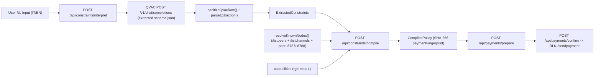
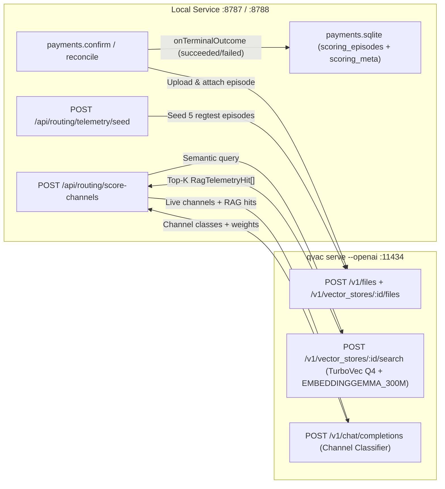

# QVAC AI Routing Architecture: Features 1 & 2 Technical Specification

This document provides the complete technical architecture, data contracts, API endpoints, safety invariants, and implementation details for **Feature 1 (Natural Language Constraint Interpretation & Deterministic Policy Compilation)** and **Feature 2 (Intelligent Channel Scoring via QVAC RAG & Classifier)** in `air-gb-lightning`.

It is designed as a primary context reference for engineers and AI coding agents working on subsequent features (such as Feature 3) or integrating with the local wallet service (`wallet/apps/local-service`) and web UI (`wallet/apps/web`).

---

## 1. High-Level System Topology & QVAC Runtime Configuration

All AI inference and Retrieval-Augmented Generation (RAG) run 100% locally over `qvac serve --openai` bound to `http://127.0.0.1:11434`. No external cloud APIs are used, and the AI layer never holds signing keys or directly executes payments.

### 1.1 `wallet/qvac.config.json`

```json
{
  "ragTurbovec": true,
  "serve": {
    "host": "127.0.0.1",
    "port": 11434,
    "corsOrigin": [
      "http://127.0.0.1:8787",
      "http://localhost:8787",
      "http://127.0.0.1:8788",
      "http://localhost:8788"
    ]
  },
  "models": {
    "my-llm": {
      "src": "registry://hf/Qwen/Qwen3-8B-GGUF/blob/main/Qwen3-8B-Q4_K_M.gguf",
      "type": "llamacpp-completion",
      "preload": true,
      "default": true,
      "config": { "ctx_size": 8192, "device": "gpu", "tools": true }
    },
    "qwen-fast": {
      "src": "registry://hf/unsloth/Qwen3.5-0.8B-GGUF/resolve/6ab461498e2023f6e3c1baea90a8f0fe38ab64d0/Qwen3.5-0.8B-Q4_K_M.gguf",
      "type": "llm",
      "preload": false,
      "default": false,
      "config": { "ctx_size": 8192, "device": "gpu", "tools": true }
    },
    "my-embed": {
      "src": "registry://EMBEDDINGGEMMA_300M_Q4_0",
      "type": "llamacpp-embedding",
      "preload": false,
      "default": true,
      "config": {
        "ctx_size": 2048,
        "pooling_type": "mean",
        "ubatch_size": 2048,
        "batch_size": 2048,
        "device": "gpu"
      }
    }
  }
}
```

### 1.2 Why `"ragTurbovec": true` Is Enabled
QVAC's OpenAI-compatible server (`qvac serve --openai`) exposes `/v1/files` and `/v1/vector_stores` backed by `@tetherto/qvac-sdk-RAG`.
- Without `"ragTurbovec": true`, QVAC defaults to `HyperDBAdapter` with `n centroids = 1` and `bucketSize = 50` on single-document ingests (`POST /v1/vector_stores/:id/files`), which triggers FIFO eviction after 50 chunks.
- With `"ragTurbovec": true`, QVAC instantiates `TurboVecAdapter` (`turbovec-q4` native SIMD quantized index paired with HyperDB full-precision reranking over 768-dim `EMBEDDINGGEMMA_300M_Q4_0` vectors), supporting incremental ingestion without single-bucket FIFO eviction.

---

## 2. Native Rust Backend Contract (`vendor/rgb-lightning-node`)

The local service communicates with the locked `rgb-lightning-node` daemon (`infra/native/source-lock.json`, commit `f9a0d788b7683e669faad311d85a080ba1ba153d`).

### 2.1 `/sendpayment` Routing Payload (`src/routes.rs`)
The Rust node accepts a `routing: Option<RoutingPolicy>` field in `POST /sendpayment`:

```rust
#[derive(Debug, Clone, Deserialize, Serialize)]
#[serde(tag = "algorithm", rename_all = "snake_case")]
pub enum RoutingPolicy {
    LdkDijkstra {
        #[serde(default)]
        max_fee_msat: Option<u64>,
        #[serde(default)]
        excluded_nodes: Vec<String>,
        #[serde(default)]
        max_paths: Option<u8>,
    },
    Yen {
        #[serde(default)]
        max_fee_msat: Option<u64>,
        #[serde(default)]
        excluded_nodes: Vec<String>,
        #[serde(default)]
        max_paths: Option<u8>,
    },
    MinCostFlow {
        #[serde(default)]
        max_fee_msat: Option<u64>,
        #[serde(default)]
        excluded_nodes: Vec<String>,
        #[serde(default)]
        max_paths: Option<u8>,
    },
    MultiObjective {
        weights: ObjectiveWeights,
        #[serde(default)]
        max_fee_msat: Option<u64>,
        #[serde(default)]
        excluded_nodes: Vec<String>,
        #[serde(default)]
        max_paths: Option<u8>,
    },
}

pub struct ObjectiveWeights {
    pub fee: u32,
    pub reliability: u32,
    pub cltv: u32,
    pub hops: u32,
}
```

Wait-free & retry guarantees in Rust (`vendor/rgb-lightning-node/src/ldk.rs`):
- Every algorithm constructs an LDK `RouteParameters` where `max_total_routing_fee_msat` is set to `max_fee_msat`.
- `excluded_nodes` (compressed secp256k1 hex pubkeys) are filtered out of candidate hops during graph traversal and passed to LDK's `find_route`.
- `max_paths: Some(1)` disables multi-part splitting/probing and forces single-path routing.
- `MultiObjective` combines `weights: { fee, reliability, cltv, hops }` with LDK's live `ProbabilisticScorer` (`estimated_channel_liquidity_range` and `historical_estimated_payment_success_probability`) to score every candidate edge in the network graph.

---

## 3. Feature 1: Natural Language Constraint Interpretation & Deterministic Policy Compilation

### 3.1 Architecture & Data Flow



### 3.2 Key Files
- `wallet/packages/contracts/extracted.schema.json`: Strict JSON Schema (`draft-07`, `additionalProperties: false`) for QVAC's structured output.
- `wallet/packages/contracts/types.ts`: TypeScript definitions for `ExtractedConstraints`, `RoutingCapabilities`, `CompiledPolicy`, `CompileResult`, `PaymentRouting`.
- `wallet/apps/local-service/interpret.ts`:
  - `interpretWithQvac(text, signal)`: Calls QVAC `POST /v1/chat/completions` with `temperature: 0`, `max_tokens: 512`, `reasoning_budget: false`, and `response_format: { type: 'json_schema', json_schema: { name: 'routing_constraints', strict: true, schema } }`.
  - `sanitizeQvacRaw(raw, text)`: Deterministic post-processor that normalizes priorities (`lowest_fee`, `reliability`, `balanced`), privacy requests (`avoid_extra_probing`, `unspecified`), fee caps (`lte` vs `lt` in `sat` or `msat`), node exclusions vs negations (`"non evitare X"` / `"do not exclude X"`), and flags out-of-scope or ambiguous requests (`"invia subito"`, `"circa 10 sat"`, `"2 euro"`, `"pagamento garantito"`).
  - `parseExtraction(raw, text)`: Validates the JSON against `extracted.schema.json` via Ajv (`strict: true`) and runs semantic anti-hallucination checks verifying that every extracted fee amount, unit, node reference, priority, or privacy request actually appears in the user's input text.
- `wallet/packages/policy/compile.ts`:
  - `feeToMsat(limit)`: Exact `BigInt` conversion from `sat` or `msat` to millisatoshis. Handles strict inequality (`comparison: 'lt'` subtracts `1n` msat; `< 0` throws). Rejects sub-msat precision (e.g., `0.0001 sat`).
  - `validNodeId(value)`: Verifies 33-byte compressed secp256k1 public keys (`^(02|03)[0-9a-fA-F]{64}$`) and validates point decompression via Node's `crypto.ECDH.convertKey(..., 'secp256k1')`.
  - `fingerprint(payment)`: Computes `SHA-256(JSON.stringify({ invoice, amount, assetId, network }))` so a `CompiledPolicy` is cryptographically bound to one exact payment draft.
  - `compileConstraints({ extracted, payment, capabilities, knownNodes, payeePubkey })`:
    1. Rejects non-`parsed` statuses or non-empty `unhandledRequests` (`status: 'needs_clarification'`, `code: 'INVALID_EXTRACTION'`).
    2. Resolves `excludedNodeReferences` against `validNodeId()` or case-insensitive alias lookup in `knownNodes`. Fails closed (`NODE_UNRESOLVED`) if an alias is unknown or ambiguous (matches >1 pubkey).
    3. Rejects exclusions that match the invoice's `payeePubkey` (`status: 'conflict'`, `code: 'CONSTRAINT_CONFLICT'`).
    4. Checks `capabilities` (`hardFeeCap`, `hardNodeExclusion`, `perPaymentScoringProfile`, `avoidExtraProbing`, `canGuaranteeConstraintsAcrossRetries`). Fails closed (`CONSTRAINT_UNSUPPORTED`) if any requested capability is disabled.
    5. Emits a `CompiledPolicy` (`status: 'validated'`).

### 3.3 Dynamic Node Alias Resolution (`server.ts` & `wallet.ts`)
- `wallet.knownNodes()` (`wallet/apps/local-service/wallet.ts`) collects connected peer pubkeys from `/listpeers` and `/listchannels` and assigns deterministic aliases (`peer-<pubkey_prefix>`).
- `resolveKnownNodes()` (`wallet/apps/local-service/server.ts`) merges:
  1. `wallet.knownNodes()`
  2. Live local peer service discovery across ports `8787` (`Alice`) and `8788` (`Bob`) via `/api/session` + `/api/wallet/summary` (`nodeId`), so users can write `"evita Bob"` or `"avoid Alice"` in natural language on regtest without manually typing 66-char hex pubkeys.
  3. Any custom `{ alias, pubkey }[]` passed in the request body.
- Exposed at `GET /api/routing/known-nodes`.

### 3.4 Payment Preparation & Enforcement (`payments.ts`)
When `POST /api/payments/prepare` is called:
1. `parseCompiledPolicy(input.constraints)` validates the `CompiledPolicy` structure, schemaVersion, and secp256k1 pubkeys.
2. `PaymentStore.prepare()` decodes the BOLT11 invoice via `wallet.decodeLightning()` and verifies that `policy.paymentFingerprint` matches `fingerprint({ invoice, amount, assetId, network })`. If the invoice or amount was changed after compiling constraints, it throws `CONSTRAINT_MISMATCH`.
3. `applyPolicyToRouting(baseRouting, policy)` merges the policy into `PaymentRouting`:
   - `policy.hard.maxRoutingFeeMsat` $\rightarrow$ `routing.max_fee_msat`
   - `policy.hard.excludedNodeIds` $\rightarrow$ `routing.excluded_nodes`
   - `policy.soft.privacyPreference === 'avoid_extra_probing'` $\rightarrow$ `routing.max_paths = 1`
4. In the Web UI (`PaymentPanel.tsx`), `soft.priority` automatically pre-selects `multi_objective` weights:
   - `'lowest_fee'` $\rightarrow$ `{ fee: 100, reliability: 10, cltv: 5, hops: 5 }`
   - `'reliability'` $\rightarrow$ `{ fee: 10, reliability: 100, cltv: 10, hops: 10 }`

---

## 4. Feature 2: Intelligent Channel Scoring via QVAC RAG & Classifier

### 4.1 Architecture & Data Flow

Feature 2 augments LDK's internal `ProbabilisticScorer` with a **QVAC TurboVec RAG Telemetry Store** + **Structured Channel Classifier** that evaluates every local channel's liquidity, RGB asset balance, peer status, and historical payment/anomaly episodes before a payment is prepared.



### 4.2 Key Files
- `wallet/packages/contracts/channel-score.schema.json`: Strict JSON Schema for the channel scoring classifier output.
- `wallet/packages/contracts/types.ts`: Exports `ChannelClassification`, `ChannelScoreProfile`, `ChannelScoreEntry`, `RagTelemetryHit`, `TelemetryEpisode`, `ChannelClassifierOutput`, and `ChannelScoringResult`.
- `wallet/apps/local-service/channel-scoring.ts`: Implements `formatTelemetryDocument()`, `QvacRagStore`, `sanitizeAndValidateChannelScore()`, and `scoreChannelsWithQvac()`.
- `wallet/apps/local-service/payments.ts`: Triggers `onTerminalOutcome(record)` whenever `confirm()` or `reconcile()` transitions an intent to `'succeeded'` or `'failed'`.
- `wallet/apps/local-service/server.ts`: Wires `recordPaymentEpisode` into `PaymentStore` and exposes `/api/routing/telemetry`, `/api/routing/telemetry/seed`, and `/api/routing/score-channels`.
- `wallet/apps/web/src/components/PaymentPanel.tsx`: Provides the UI controls and visual telemetry/classification badges.

### 4.3 RAG Telemetry Document Formatting & Chunking (`channel-scoring.ts`)
QVAC's `POST /v1/vector_stores/:id/files` uses `LLMChunkAdapter` (`llm-splitter` with `chunkSize: 100`, paragraph separator `['\n\n', '\n', ' ']`).
To ensure each payment/channel episode stays in **a single atomic embedding chunk** with full context:
- `formatTelemetryDocument(episode: TelemetryEpisode)` formats a compact (<150 token), single-paragraph UTF-8 text block:

```text
[TELEMETRY ep-demo-rgb-success-01] Event=payment_succeeded Outcome=succeeded Peer=Bob (02c604...) Channel=ch-bob-primary-01. Payment=3000000 msat over RGB asset rgb:2eVw8uw-... (amount 25) using algorithm=multi_objective. OutboundLiquidityRatio=78% Fee=120 msat. Notes: Pagamento RGB completato al primo tentativo verso Bob con ampia liquidità outbound (78%) e fee contenute.
```

### 4.4 `QvacRagStore` Lifecycle & Persistence (`channel-scoring.ts`)
`QvacRagStore` shares `payments.sqlite` in the wallet data directory (`wallet.dataDir`) and maintains two tables:
1. `scoring_meta (key TEXT PRIMARY KEY, value TEXT NOT NULL)` — stores `vector_store_id`.
2. `scoring_episodes (id TEXT PRIMARY KEY, timestamp INTEGER, event_type TEXT, peer_node_id TEXT, peer_alias TEXT, channel_id TEXT, amount_msat TEXT, asset_id TEXT, asset_amount TEXT, routing_algorithm TEXT, outcome TEXT, failure_reason TEXT, outbound_ratio_pct INTEGER, fee_msat INTEGER, notes TEXT, document_text TEXT, qvac_file_id TEXT, vector_store_id TEXT)`.

Key methods on `QvacRagStore`:
- `ensureVectorStore(signal)`: Checks if a saved `vector_store_id` exists in `GET /v1/vector_stores` on `qvac serve`, or finds/creates one named `airgb-channel-telemetry` via `POST /v1/vector_stores`.
- `ingestEpisode(episode, signal)`:
  1. Checks `scoring_episodes` in SQLite; if already synced with a `qvac_file_id` and `vector_store_id`, returns immediately (idempotent deduplication).
  2. Persists the episode in SQLite first (so local history works even if QVAC is offline).
  3. Uploads the UTF-8 telemetry document to `POST /v1/files` (`multipart/form-data`, `purpose: 'assistants'`).
  4. Attaches the returned `file_id` to `POST /v1/vector_stores/:id/files` (which runs `LLMChunkAdapter` + `EMBEDDINGGEMMA_300M_Q4_0` embedding and saves into the TurboVec workspace).
  5. Updates `qvac_file_id` and `vector_store_id` in SQLite.
- `searchEpisodes(query, topK = 4, signal)`:
  1. Calls `POST /v1/vector_stores/:id/search` with `{ query, max_num_results: topK }`.
  2. Extracts `RagTelemetryHit[]` (`{ fileId, filename, score, text }`).
  3. **Offline/Empty Fallback**: If QVAC is unreachable or the vector store has 0 hits, performs keyword overlap scoring against the local SQLite `scoring_episodes` table so scoring remains functional in offline unit tests or before seeding.
- `seedDemoEpisodes({ channels, knownNodes }, signal)`:
  - Generates 5 realistic regtest episodes (2 successful RGB transfers on high-outbound channels, 1 low-fee BTC transfer on `min_cost_flow`, 1 `TemporaryChannelFailure` RGB liquidity exhaustion on a congested channel at 14% outbound ratio, and 1 fee-spike/HTLC-timeout anomaly during MPP probing) bound to the node's actual channel IDs and peer pubkeys when available, and ingests them into QVAC.

### 4.5 QVAC Structured Channel Classifier & Grammar Optimization (`scoreChannelsWithQvac`)

`scoreChannelsWithQvac(input, ragStore, signal)` performs the following steps:
1. **RAG Retrieval**: Builds a semantic query from the payment asset (`RGB asset <id>` vs `BTC Lightning payment`), `amountMsat`, known peer aliases, and `userPreference`, and retrieves the top-K relevant episodes via `ragStore.searchEpisodes()`.
2. **Feature Engineering**: Computes per-channel deterministic features:
   - `outboundRatioPct`: `outboundMsat / (outboundMsat + inboundMsat)` (or `outboundMsat / (capacitySat * 1000)`).
   - `canCoverMsat`: `BigInt(outboundMsat) >= BigInt(amountMsat)`.
   - `canCoverAsset`: `true` for BTC payments, or `channel.assetId === input.assetId && BigInt(channel.assetLocalAmount) >= BigInt(input.assetAmount)` for RGB payments.
   - `isUsable`: boolean status from RLN `/listchannels`.
3. **Dynamic Grammar Schema for Small Models (`qwen-fast` 0.8B & `my-llm` 8B)**:
   - In `POST /v1/chat/completions`, `scoreChannelsWithQvac` constructs a per-request `dynamicInferenceSchema` where:
     - `channels.minItems` and `channels.maxItems` are locked to `input.channels.length`.
     - `channels.items.properties.channelId` is constrained to `{ enum: candidateChannelIds }`.
     - `peerNodeId` (66-char hex) is omitted from the LLM generation schema and re-attached deterministically in `sanitizeAndValidateChannelScore()` so small GGUF models (`qwen-fast`) never waste tokens repeating 66-char hex strings or looping array items until `max_tokens` (`finish_reason: "length"`).
4. **Deterministic Post-Processing & Safety Invariants (`sanitizeAndValidateChannelScore`)**:
   - **Physical Hard Constraints Override**: If a live channel has `isUsable === false`, its classification is forced to `'avoid'` (score `5`). If `outboundMsat < amountMsat` or RGB `assetLocalAmount < assetAmount`, its classification is forced to `'insufficient_liquidity'` (score `20`–`25`). The LLM cannot promote an unusable or underfunded channel to `'optimal'` or `'good'`.
   - **Score Range Normalization (`normalizeScoreForClass`)**: Ensures the numeric `score` (`0..100`) is consistent with the assigned `ChannelClassification` (`optimal`: `80..100`, `good`: `65..85`, `congested`: `35..60`, `unreliable`: `20..45`, `insufficient_liquidity`: `10..30`, `avoid`: `0..15`).
   - **Profile & Weight Alignment**: Maps `overallProfile` (`balanced`, `fee_saver`, `high_reliability`, `liquidity_preserving`, `single_path_privacy`) and user preferences/policies to bounded integer `ObjectiveWeights` (`1..1000`).
   - **Safe Node Exclusions**: Any peer whose candidate channels are **all** classified as `'avoid'` is added to `excludedNodeIds`, **except** `payeePubkey` (the invoice destination node is never excluded, preventing self-inflicted routing failure on direct peers).
   - **Policy Merging**: Merges `recommendedWeights` and `excludedNodeIds` with any active `CompiledPolicy` (`hard.maxRoutingFeeMsat`, `hard.excludedNodeIds`, `soft.privacyPreference === 'avoid_extra_probing'` $\rightarrow$ `max_paths: 1`) to return a ready-to-use `recommendedRouting: PaymentRouting`.

---

## 5. HTTP API Reference (`wallet/apps/local-service/server.ts`)

All `POST` and protected `GET` endpoints require the session header `x-session-token` (obtained from `GET /api/session`) and a valid loopback `Origin` header.

| Method | Path | Purpose |
| :--- | :--- | :--- |
| `GET` | `/api/routing/capabilities` | Returns frozen `RoutingCapabilities` (`revision: 'rgb-mpp-1'`). |
| `GET` | `/api/routing/known-nodes` | Returns `{ alias, pubkey }[]` from RLN peers/channels + local regtest peer services (`:8787` Alice, `:8788` Bob). |
| `POST` | `/api/constraints/interpret` | Accepts `{ text: string }`. Calls QVAC (`extracted.schema.json`), sanitizes, and returns `{ extracted: ExtractedConstraints, latencyMs }`. |
| `POST` | `/api/constraints/compile` | Accepts `{ extracted, payment, knownNodes? }`. Decodes the BOLT11 invoice on RLN, verifies amounts/assets, and returns `CompileResult` (`CompiledPolicy`). |
| `GET` | `/api/routing/telemetry` | Returns `{ vectorStoreId, ragBackend: 'qvac-turbovec', count, episodes: TelemetryEpisode[] }`. |
| `POST` | `/api/routing/telemetry/seed` | Seeds 5 curated RGB/BTC regtest telemetry episodes into SQLite and QVAC's `/v1/vector_stores` workspace. |
| `POST` | `/api/routing/score-channels` | Accepts `{ invoice?, amountMsat?, assetId?, assetAmount?, payeePubkey?, userPreference?, constraints?, channels?, knownNodes? }`. Runs TurboVec RAG search + QVAC channel classification and returns `ChannelScoringResult`. |
| `POST` | `/api/payments/prepare` | Accepts `{ id, invoice, amountMsat?, constraints?, routing }`. Verifies `CompiledPolicy` fingerprint, merges `max_fee_msat` / `excluded_nodes` / `max_paths`, and saves the idempotent payment intent in SQLite. |
| `POST` | `/api/payments/confirm` | Executes `/sendpayment` on RLN with the persisted `PaymentRouting` and auto-ingests the terminal outcome (`succeeded` / `failed`) into `QvacRagStore`. |

---

## 6. Web UI Integration (`wallet/apps/web/src/components/PaymentPanel.tsx`)

Inside `PaymentPanel.tsx` (after decoding a BOLT11 invoice):
1. **Natural Language Routing Constraints (Feature 1)**:
   - User enters free-form Italian or English constraints in the textarea and clicks **"Analizza vincoli con QVAC"**.
   - Calls `POST /api/constraints/interpret` followed by `POST /api/constraints/compile`.
   - When `compile.status === 'validated'`, the UI automatically applies soft priority weights (`multi_objective`) and attaches `compile.policy` to `POST /api/payments/prepare`.
   - Any edit to the invoice or amount invalidates the compiled policy until re-analyzed.
2. **Intelligent Channel Scoring via QVAC RAG (Feature 2)**:
   - **"Valuta canali con QVAC (RAG + Classifier)"** calls `POST /api/routing/score-channels` with the decoded invoice, current NL text (`userPreference`), and any validated `CompiledPolicy`.
   - Automatically switches the routing algorithm to `multi_objective` with `recommendedWeights` (`fee`, `reliability`, `cltv`, `hops`) and applies `excluded_nodes` / `max_paths`.
   - Displays per-channel classification badges (`optimal`, `good`, `congested`, `insufficient_liquidity`, `unreliable`, `avoid`), numeric scores (`0–100`), outbound liquidity in sat, RGB local balances, and the top retrieved RAG telemetry hits with cosine similarity scores.
   - **"Popola telemetria RAG demo"** calls `POST /api/routing/telemetry/seed` so users can immediately test RAG retrieval and channel scoring on fresh regtest setups.

---

## 7. Verification & Smoke Test Commands

Run from `/home/pesce/GitLab_Projects/air-gb-lightning/wallet`:

```bash
# TypeScript typecheck across all workspaces (local-service, web, contracts, policy)
npm run typecheck

# Full unit & integration test suite (33 tests covering Feature 1, Feature 2, RLN, and SQLite)
npm test

# Production Vite build for @airgb/web
npm run build

# API security & constraint enforcement smoke test
node --import tsx infra/regtest/smoke-api.mjs

# Live QVAC Feature 1 smoke test (34/34 Italian & English phrases in tests/phrases.json)
npm run qvac:smoke

# Live QVAC Feature 2 smoke test (TurboVec RAG /v1/vector_stores ingestion, search & classification)
npm run qvac:smoke:scoring
```
